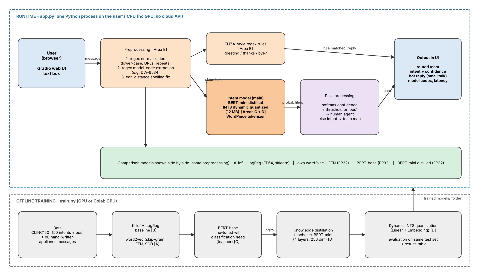

# Customer Support Ticket Router

SWE015 – Introduction to Large Language Models · Homework: *Building an Intelligent Application* · **Use Case 2**

A support message such as *"my dishwaser is not draining, model DW-6534"* is normalized with regular
expressions, spell-corrected with minimum edit distance, and classified into one of 154 intents (or
*out-of-scope*) by a **distilled and INT8-quantized BERT-mini**. Then it is routed to a support team.
Low-confidence and out-of-scope messages go to a **human agent**, and greetings get an ELIZA-style rule-based reply.
The app shows all models of the ladder side by side.



## Setup

Python 3.10 or newer. Training was tested with PyTorch 2.15, Transformers 5.24, scikit-learn 1.9, gensim 4.4 and Gradio 6.

```bash
git clone <this-repo-url> ticket-router
cd ticket-router
python -m venv .venv
source .venv/bin/activate          # Windows: .venv\Scripts\activate
pip install -r requirements.txt
```

## Get the trained models (choose one)

The weights are **not** in this repository (too large). Choose one of these options:

* **Train them yourself** (downloads the data and the pretrained BERTs from Hugging Face automatically):
  ```bash
  python train.py
  ```
  This takes about 45 minutes on a 4-core CPU, mostly fine-tuning BERT-base. On Google Colab with a GPU it takes a few minutes.
  `python train.py --fast` runs a 4-minute smoke test on a small subset. It writes `models/` and the results in `results/`.
* **Download them:** [models.zip](<PUT-YOUR-GOOGLE-DRIVE-OR-HF-LINK-HERE>). Unzip it so that you have `ticket-router/models/...`.
  Then run `python train.py` once. It skips the models that already exist, so it only quantizes BERT-base and
  re-evaluates everything (about 10 minutes). That way the results table is measured on your own hardware.

## Run the application (single command)

```bash
python app.py
```

Open http://127.0.0.1:7860, type a message and press **Route message**.

## Project structure

| Path | What it does |
|---|---|
| `src/data.py` | Loads CLINC150 and the 80 hand-written appliance examples, creates the train/val/test splits, and maps intent → domain → team |
| `src/preprocess.py` | **Area B:** regex normalization, model-code extraction, minimum-edit-distance spelling correction, ELIZA rules |
| `src/models.py` | tf-idf + LogReg baseline, **own word2vec + feedforward net (SGD)**, BERT fine-tuning, **distillation**, **INT8 quantization** |
| `src/evaluate.py` | Confidence threshold for out-of-scope, metrics, latency (mean of 200 runs) |
| `src/pipeline.py` | The routing pipeline shared by the evaluation and the app |
| `train.py` | Trains the full ladder, evaluates every model on the same test set, and writes `results/` |
| `app.py` | Gradio application. Its main model is BERT-mini distilled (INT8) |
| `docs/make_diagram.py` | Draws `docs/architecture.png` |
| `docs/make_slides.py` | Builds the presentation from `results/results.json` |
| `data/appliance_examples.csv` | 80 hand-written home appliance messages |

## Model ladder

| # | Model | Technique area |
|---|---|---|
| 1 | tf-idf (1-2 grams) + logistic regression | B – classical NLP baseline |
| 2 | own skip-gram word2vec → averaged vector → feedforward net (SGD + backprop, dropout) | A (+ B) |
| 3 | `bert-base-uncased` fine-tuned with a classification head (teacher) | C |
| 4 | `google/bert_uncased_L-4_H-256_A-4` (BERT-mini) distilled from the teacher (T = 2, α = 0.5) | D |
| 5 | Model 4 after dynamic INT8 quantization (Linear + Embedding), **used by the app** | D |

An extra reference row shows BERT-base after the same INT8 quantization.

## Results

See [`results/results.md`](results/results.md) (generated by `train.py`; the table there comes from your own run).
Test set: 5,520 messages (4,500 CLINC150 in-scope + 1,000 out-of-scope + 20 appliance messages).

## Data sources

* **CLINC150**: S. Larson et al., *An Evaluation Dataset for Intent Classification and Out-of-Scope Prediction*,
  EMNLP 2019. https://github.com/clinc/oos-eval (`data_full.json`, CC BY 3.0).
* **Pretrained models**: `bert-base-uncased` (Devlin et al., 2019) and `google/bert_uncased_L-4_H-256_A-4`
  (Turc et al., 2019) from the Hugging Face Hub.
* **Appliance examples**: 80 messages written for this project (`data/appliance_examples.csv`).
